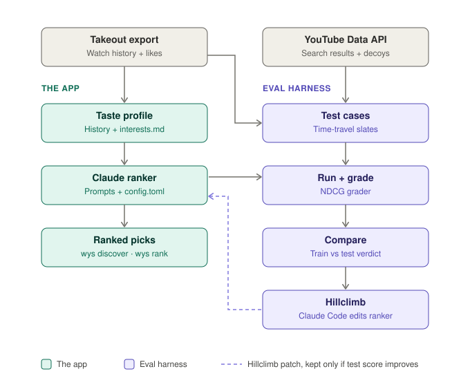

# Watch Your Step 👀

*YouTube recommendations tuned to your own history, tested by time travel.*

Watch Your Step finds long-form YouTube videos you'll actually want to watch. It reads your
Google Takeout watch history and a short note about your interests, searches YouTube, and
has Claude rank what it finds, with a one-line reason for each pick.

It also includes an eval harness built on the method in
[Automating Eval Design and Hillclimbing](https://claude.dev/blog/automating-eval-design-and-hillclimbing/),
so you can measure the recommender against your real viewing and improve it with Claude
Code's `/claude-api hillclimb`.

```
> wys discover --history "Takeout/YouTube and YouTube Music/history/watch-history.json" --top 15
Searching YouTube for 32 topics...
  searches: 32 new, 0 reused from the last 3 days, 0 failed
  446 found, 371 long-form and unwatched, ranking 60
 1. Stanford CS224N: NLP with Deep Learning | Lecture 1 — Stanford Online (80 min)
    https://youtu.be/…
    Full Stanford CS224N lecture, one of your named courses and your preferred long-form format.
 2. Blackwell GPU Power: Setting Up RTX 50 Series for AI in WSL2 — … (14 min)
    https://youtu.be/…
    RTX 50-series CUDA setup in WSL2 matches your workstation build.
 …
Page with thumbnails: data/discover.html
```

## Architecture

<p align="center">
  
</p>

**The app:** your history (long-form videos only) is condensed into a taste profile and
combined with your note from `interests.md`. Claude ranks candidate videos against it.
`wys discover` finds the candidates by searching YouTube for your topics, and `wys rank`
ranks a list you supply.

**The eval harness:** each test case freezes your history at a past date and asks for a
ranking of 10 videos. One or two are videos you really watched next; the rest are decoys you
never watched. Runs go through the same Claude ranker the app uses and are scored with NDCG.
During hillclimbing, Claude Code edits the ranker's prompts or settings and keeps a change
only if both the train and test scores improve. The ranker never sees the answers or
anything after the cutoff date.

## Setup

You need Python 3.11+, an [Anthropic API key](https://console.anthropic.com), and a free
YouTube Data API key (Google Cloud console → enable **YouTube Data API v3** →
Credentials → **API key**, choosing *Public data*).

**Windows (Command Prompt)**
```bat
cd C:\dev\watch-your-step
python -m venv .venv
.venv\Scripts\activate
pip install -e .
setx ANTHROPIC_API_KEY "sk-ant-..."
setx YOUTUBE_API_KEY "AIza..."
```
`setx` takes effect in new windows, so open a fresh one and run `.venv\Scripts\activate` again.

**macOS / Linux**
```bash
python -m venv .venv && . .venv/bin/activate
pip install -e .
export ANTHROPIC_API_KEY=sk-ant-...
export YOUTUBE_API_KEY=AIza...
```

**Export your history.** At [takeout.google.com](https://takeout.google.com), click
*Deselect all*, tick *YouTube and YouTube Music*, and under *Multiple formats* set **history**
to **JSON**. Under *All YouTube data included*, keep only *history* and *playlists*. Unzip it
into the project folder so you have:

```
Takeout/YouTube and YouTube Music/history/watch-history.json
Takeout/YouTube and YouTube Music/playlists/Liked videos.csv     (optional)
```

The commands below use that path with forward slashes, which work on Windows too.

**Look up video lengths and live streams** (once, then only for new videos):
```bash
python -m evals.fetch_durations --history "Takeout/YouTube and YouTube Music/history/watch-history.json"
```
Takeout logs every Short that played and every live stream you had open as "watched",
which is mostly feed noise rather than a choice. In one real history, 96% of watches were
Shorts, and half of the remaining long-form views were live streams. From now on, Watch Your Step
uses only long-form videos (over 3 minutes) that weren't live broadcasts. Pass
`--include-shorts` to keep Shorts.

## Discover new videos

Describe what you're into in `interests.md`. It's kept out of git, so your interests stay
private. Start from the template:

```
copy interests.example.md interests.md      (Windows)
cp interests.example.md interests.md        (macOS / Linux)
```


- **Everything above `## Searches`** is a note in your own words. Claude reads it alongside
  your history, so be specific: courses you're taking, your hardware, formats you like.
- **Each bullet under `## Searches`** is a YouTube search that `discover` runs.

Then:

```bash
wys discover --history "Takeout/YouTube and YouTube Music/history/watch-history.json" --top 15
```

It searches each topic, drops Shorts, live streams and anything you've already watched, and
has Claude rank up to 60 of the rest. You get the picks in the terminal and a page with
thumbnails at `data/discover.html`.

| Option | What it does |
|---|---|
| `--top 15` | How many picks to show |
| `--per-topic 2` | Most picks from any one search, so one interest can't crowd out the rest |
| `--max-queries 5` | Run only the first N searches (cheap test) |
| `--days 30` | Only videos published in the last N days |
| `--cache-days 3` | Reuse each search's results for this long; a rerun only searches failed or stale topics |
| `--reuse` | Re-rank the last results without searching at all, e.g. after editing your note |
| `--include-shorts` | Keep Shorts and live streams in your history |

**YouTube limits:** a new API project gets **100 searches per day** (and 100 per minute),
on top of 10,000 quota units per day. The search count is the one you'll hit: a full
`discover` run with 32 topics uses 32 searches, and decoy fetching with `--auto-queries 15`
uses 15. Length and live checks are cheap (about 1 unit per 50 videos). You can see your
usage in Google Cloud under **APIs & Services → YouTube Data API v3 → Quotas & System
Limits**. Raising the search cap needs an application to YouTube, which isn't necessary here.

Watch Your Step pauses 3 seconds between searches. If YouTube refuses one after a retry, it
stops searching for the day and ranks what it already has. Search results are cached per
topic, so the next day's run only searches the topics that are missing.

**Ranking a list you already have:** `wys rank candidates.json --history ...` ranks a JSON
list of `{"video_id", "title", "channel", "description"?}`.

## The eval

### How it maps onto the post

| Post principle | Here |
|---|---|
| Tasks mirror production | Each case freezes **your real history** at a past date and asks for a ranking of a slate |
| Real data over synthetic | Ground truth = long-form videos you actually chose to watch next |
| Adversarial sampling, explainable | Decoys include uploads from channels you watch that you skipped |
| No shortcuts | Decoys come from unfamiliar channels at the same rate your real watches do, so "pick the new channel" or "pick the favourite channel" is no better than chance. The `novelty` and `channel_freq` baselines check this |
| Cheapest grader that fits | Ranking vs known answers → programmatic `ndcg@10` (also recall@3, hit@1, MRR). No LLM judge needed |
| Validate before optimizing | `run.py` reports CIs, noise between replicates, API errors / parse failures / truncation, never-solved cases, headroom |
| Train/test split, flat test = overfit | `split.json`; `compare.py` applies keep / revert / overfit-suspected |
| Keep answers out of reach | Answers live in a separate file read only by the runner; descriptions are hidden so they can't leak |
| Human review | `review.html` shows every slate; list bad cases in `excluded.txt` |

### Building it

Commands below use `HIST` for `"Takeout/YouTube and YouTube Music/history/watch-history.json"`
and `LIKES` for `"Takeout/YouTube and YouTube Music/playlists/Liked videos.csv"`. Type the
full quoted paths.

**1. Fetch decoys** (videos you didn't watch), from your channels plus Claude-written
searches on your topics. Then check their lengths too:
```bash
python -m evals.fetch_distractors --history HIST --auto-queries 15
python -m evals.fetch_durations --history HIST
```
Claude's queries are saved to `evals/data/queries.txt`. Edit them and rerun with
`--queries evals/data/queries.txt --skip-channels` if you like.

**2. Build and review the cases:**
```bash
python -m evals.build_cases --history HIST --likes LIKES --span-days 730 --positives 1 --horizon-days 3 --n-cases 60
python -m evals.review       # writes evals/cases/review.html
```
With a modest amount of long-form viewing, one answer per slate over 3-day windows gives the
most cases. Check that it prints `Decoys matched to that rate` with no warnings. In the
review page, green rows are what you really watched next. If one is clearly accidental (an
autoplay), add its case id on its own line in `evals/cases/excluded.txt` (`#` starts a
comment). Keep cases that are merely hard.

**3. Baselines.** Make sure the eval separates good rankings from bad before optimizing:
```bash
python -m evals.run --label random    --backend random --reps 3
python -m evals.run --label novelty   --backend novelty         # should match random
python -m evals.run --label heuristic --backend channel_freq    # should match random
python -m evals.run --label sonnet    --reps 3
python -m evals.run --label haiku     --model claude-haiku-5-5
python -m evals.run --label opus      --model claude-opus-5-5
```
With one answer per 10-video slate, random scores about 0.45. If `novelty` or `heuristic`
clearly beats random, the eval has a shortcut: fix the cases, don't exploit it. You want
Claude clearly above random, and Opus at or above Haiku.

**4. Compare runs** with the post's keep/revert rule:
```bash
python -m evals.compare sonnet try-1
```

**5. Hillclimb.** In Claude Code at the repo root:
```
/claude-api hillclimb
```
`CLAUDE.md` lists the editable surfaces (prompts, `config.toml`, `profile.py`) and the
overfitting rules. `/claude-api build-eval` can audit these cases or add a second eval.

**Your interests note in the eval:** left out by default, because it was written today and
would hint at past choices. `python -m evals.run --label notes --reps 3 --with-interests`
measures what it adds.

## Costs and token usage

**Claude** is billed per token to your Anthropic account. Put the current prices for each
model you use in `config.toml` (USD per million tokens):

```toml
[pricing."claude-sonnet-5-5"]
input = 2.0
output = 10.0
```

Add a matching `[pricing."<model>"]` section for any model you try with `--model`.

Every eval run then reports what it used, per split:

```
  all: ndcg@10=0.469  95% CI [0.423, 0.522]  n=55  errors=0 parse_fail=0
       tokens in 430,000 / out 75,000  cost $2.15 (1.30¢/call)
```

The same numbers appear in `report.html` and in `summary.json` (`tokens`,
`cost_per_case_usd`). `python -m evals.compare A B` shows the cost change between two
runs. `--goal cost` keeps a change only if it's cheaper and neither split's score drops,
which is useful for checking whether a smaller model holds up.

Typical costs on Sonnet 5.5, measured on a real history:

| Run | Claude calls | Approx. cost |
|---|---|---|
| `wys discover` (ranks up to 60 videos) | 1 | ~5–8¢ |
| `wys discover --reuse` | 1 | ~5–8¢, and no YouTube searches |
| Eval, 55 cases × 1 rep | 55 | ~$0.70 |
| Eval, 55 cases × 3 reps | 165 | ~$2.15 |
| Eval on Opus 5.5 | | about 2× Sonnet |

For cheap checks while hillclimbing, use `--reps 1`, `--split train` or `--limit 10`.

**YouTube** is free within the daily limits described under
[Discover new videos](#discover-new-videos): 100 searches and 10,000 quota units.

## Privacy

Your Takeout export, your `interests.md`, the `data/` caches, eval cases and results are all
in `.gitignore`. Only code, prompts, `config.toml` and the `interests.example.md` template
are committed.

## Troubleshooting

| You see | Do this |
|---|---|
| `YouTube refused the search request` / `429` | Usually the 100-searches-per-day cap. It resets at midnight Pacific time; finished topics are reused |
| `Set YOUTUBE_API_KEY` or an Anthropic auth error | Open a new terminal after `setx`, and activate `.venv` again |
| `Claude's ranking couldn't be read` | The raw reply is in `data/discover_raw.txt`; send it to whoever is debugging |
| `UnicodeEncodeError` on Windows | Update to the latest code; all files are read and written as UTF-8 |
| `No video lengths cached` | Run `python -m evals.fetch_durations --history ...` first |

## Try it without your data

```bash
python scripts/make_demo_data.py
python -m evals.build_cases --history "demo/Takeout/YouTube and YouTube Music/history/watch-history.json" --include-shorts
python -m evals.run --label random --backend random --reps 3
python -m evals.run --label heuristic --backend channel_freq
python -m evals.compare random heuristic
python -m pytest -q tests
```

## Layout

```
interests.md            your note + search topics (private; copy interests.example.md)
src/watchyourstep/      cli.py (wys) · discover.py · recommender.py · profile.py
                        takeout.py (parser) · youtube.py (API, lengths, live flags)
prompts/                system.md · user_template.md            ← hillclimb surfaces
config.toml             model, max_tokens, API params, profile   ← hillclimb surface
evals/                  fetch_distractors · fetch_durations · build_cases · review
                        run · grader · compare · report · stats
data/                   caches and discover output (gitignored)
docs/                   architecture.svg
scripts/                make_demo_data.py
tests/                  offline tests (stubbed YouTube and Claude)
```

## Ideas for later

- **Daily digest:** run `wys discover --days 7` on a schedule and email the page.
- **Explicit feedback:** log 👍/👎 on picks and turn them into new eval cases (production
  traces, as the post recommends).
- **Second eval:** an LLM judge scoring each reason against a rubric of checkable claims
  (cites a real pattern from your history, no invented facts).
